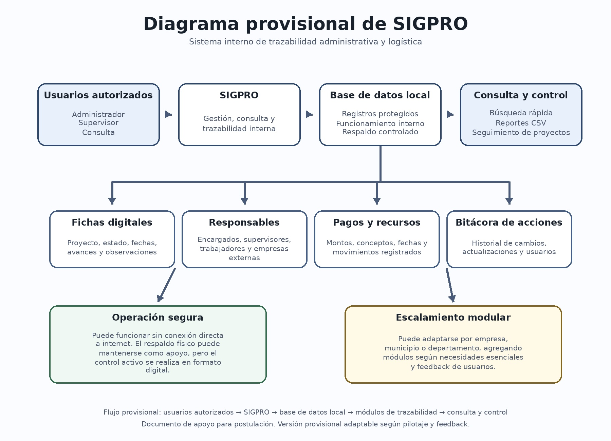

# SIGPRO - Prototipo funcional en Python

Prototipo presentado a Inacap Ideas 2026 (concurso de innovación de INACAP), que llegó a la tercera etapa de evaluación.

**SIGPRO** es un prototipo local de un sistema interno de trazabilidad administrativa y logística para proyectos.
Funciona en terminal, usa **SQLite** y no requiere conexión a internet ni librerías externas.

## Qué demuestra

- Registro de personas, responsables, supervisores y personal involucrado.
- Creación y seguimiento de proyectos.
- Ficha digital del proyecto.
- Estados de avance.
- Registro de actualizaciones, retrasos, observaciones y riesgos.
- Registro de pagos o movimientos.
- Bitácora de acciones del sistema.
- Exportación de reporte de proyectos a CSV.
- Roles básicos de usuario: admin, supervisor y consulta.
- Funcionamiento local, útil para explicar operación interna/offline.



## Requisitos

- Python 3.10 o superior recomendado.
- No requiere instalar paquetes externos.

## Cómo ejecutarlo

En Windows, abre CMD o PowerShell dentro de la carpeta del proyecto y ejecuta:

```bash
python sigpro.py
```

En Linux/Mac:

```bash
python3 sigpro.py
```

## Usuarios iniciales

Son credenciales de demostración, creadas por el propio programa al iniciarse, y deben cambiarse en cualquier uso real.

| Usuario | Contraseña | Rol |
|---|---|---|
| admin | admin123 | admin |
| supervisor | supervisor123 | supervisor |
| consulta | consulta123 | consulta |

## Recomendación para demo

1. Iniciar sesión como `admin`.
2. Usar la opción **13. Generar datos demo**.
3. Revisar la opción **5. Ver ficha digital de proyecto**.
4. Revisar la opción **11. Ver bitácora de acciones**.
5. Exportar con la opción **12. Exportar proyectos a CSV**.

## Archivos generados

Al ejecutar el sistema, se crea automáticamente:

- `sigpro.db`: base de datos local SQLite.
- Carpeta `exportaciones/`: reportes CSV generados.

## Nota para postulación

Este prototipo no busca ser una versión final visual. Es una prueba funcional para demostrar que la propuesta puede operar como sistema interno de trazabilidad, consulta y actualización de proyectos.

## Estado del proyecto

Prototipo funcional de terminal; el siguiente paso natural es una interfaz web y usuarios con permisos por proyecto.
